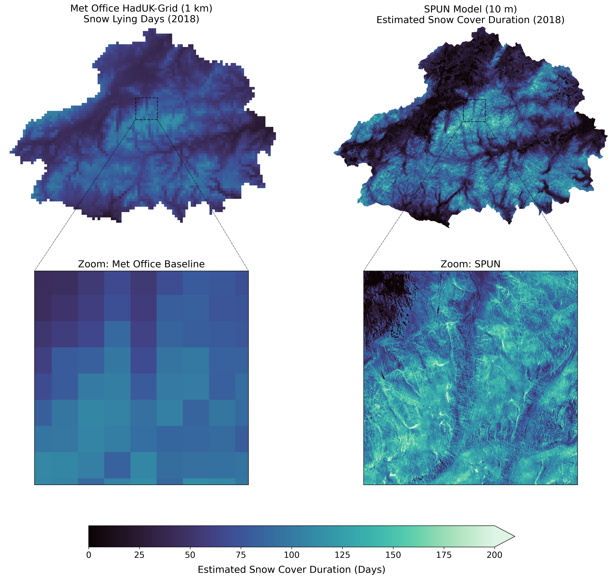

# A Snow Patch U-Net (SPUN)


## Overview

**SPUN** (Snow Patch U-Net) is a deep learning pipeline built on PyTorch and TorchGeo, designed to predict continuous Snow Cover Fraction (SCF) from multi-spectral Sentinel-2 imagery.

Developed to handle the challenging marginal snow conditions and frequent cloud cover of the Scottish Highlands, SPUN leverages self-supervised pre-trained backbones (DINO) and a custom combined loss function (Huber + Dice) to generate high-resolution (10m) SCF maps.

### Example use case - Cairngorms National Park snow persistence:

As an example of the potential of SPUN, we mapped snow across the entire Sentinel-2 archive covering the Cairngorms National Park, Scotland. We used these maps to generate an estimate of snow persistence, normalising by cloud-free views (i.e., total snow views / total clear views for each pixel). The plot below shows a comparison of the estimated Snow Cover Duration (eSCD) in 2018 using the SPUN model (right) against the best currently available baseline, the UK Met Office HadUK product (left):




The SPUN persistence map effectively highlight both naturally occurring late-lying snow patches, such as Ciste Mhearad (Margaret's Coffin), and localised, wind-driven snow accumulation around the Cairngorm ski centre infrastructure. The sub-grid processes revealed here provide a much richer dataset for investigating localised exological and hydrological processes.

## 📂 Repository Structure

The repository is organised to strictly separate source code, model training, and evaluation pipelines:

* **`src/`**: Core PyTorch modules, including the Lightning trainer, custom combined loss functions, and the `Snows2Dataset` PyTorch `Dataset` class.
* **`scripts/`**: Executable scripts for model training, hyperparameter tuning (`optuna`), and SLURM submission.
* **`training/`**: Stores training outputs, including model checkpoints, final `.pt` weights, hyperparameter tradeoff plots, and band importance logs.
* **`results/evaluation/`**: Contains the rigorous, reproducible evaluation pipelines comparing SPUN to baselines (NDSI, Let-It-Snow, Wang 2022).
    * `scotland/`: Pipeline for 1km × 1km chip-based evaluation (Multi-res metrics and Hydrological union-snow evaluation).
    * `global_wang2022/`: Pipeline for Scene-Level evaluation on massive contiguous tiles, including CloudScore+ mask ablation studies.


* **`example_notebooks/`**: Interactive tutorials, including a quickstart guide for running inference on new imagery.

## 🚀 Quickstart: Inference

If you just want to load the pre-trained SPUN model and run predictions on Sentinel-2 `.zarr` files, check out the interactive tutorial:
🔗 **[`example_notebooks/01_quickstart_inference.ipynb`](https://www.google.com/search?q=example_notebooks/01_quickstart_inference.ipynb)**

## 🏋️ Training the Model

You can download the trained model from here: https://doi.org/10.5281/zenodo.20055817 

If you want to train the model from scratch see [`training_scripts/README.md`](training_scripts/README.md) for more details.

## 📊 Evaluation Pipelines

SPUN is evaluated across two distinct environments on the [Scotland dataset](https://doi.org/10.5281/zenodo.20055817) and also an independent global dataset ([Wang et al., 2022](https://github.com/yiluyucheng/SnowCoverage/tree/main)). Please see the dedicated `README.md` files within each evaluation directory for specific bash commands and prerequisite data instructions.

### 1. Scottish Highlands 1km Chip Evaluation

**Location:** `results/evaluation/scotland/`
Compares SPUN against LIS, NDSI, and Wang et al., 2022 on 1km × 1km chips centered on highly complex, patchy terrain.

* **Multi-Resolution Evaluation:** Evaluates native 10m performance, then coarsens to 20m for direct comparison with the operational LIS baseline under clear-sky and all-sky conditions.
* **Snow Covered Area Evaluation:** Assesses performance exclusively on the area of estimated snow cover per image chip to determine utility for downstream hydrological modeling.

### 2. Global Scene-Level Evaluation

**Location:** `results/evaluation/global_wang2022/`
Assesses macro-scale performance on massive, contiguous Sentinel-2 tiles drawn from the Wang 2022 dataset.

* **Global Benchmarking:** Calculates unified 3-class (Snow, Cloud, Background) macro-averages against previous literature.
* **Cloud Mask Ablation:** Sensitivity analysis and ablation studies justifying the integration of the continuous CloudScore+ probability mask (`cs_cdf`) into the final operational SPUN pipeline.

## ⚙️ Environment Setup

It is highly recommended to run this repository within a dedicated Conda environment. Key dependencies include:

* `torch` & `pytorch-lightning`
* `torchgeo` (Crucial for Sentinel-2 specific model weight loading)
* `albumentations`
* `zarr` & `xarray`
* `rasterio` & `geopandas`
* `wandb` 

I used [micromamba](https://mamba.readthedocs.io/en/latest/installation/micromamba-installation.html) to create the environement used in development of SPUN. For Linux, macOS, or Git Bash on Windows install with: 

```bash
"${SHELL}" <(curl -L micro.mamba.pm/install.sh)
```

The environment can then be created using command:

```bash
micromamba env create -n nameofmyenv -f environment.yml 
```

## 🗺️ Roadmap & Ongoing Development

We are actively working to expand SPUN's capabilities and make it easier to use:

- [x] Create a quick inference tutorial notebook.
- [ ] Create additional tutorial notebooks, e.g create a now persistence map.
- [ ] Add script to generate snowmap directly from S2 tile identifier.
