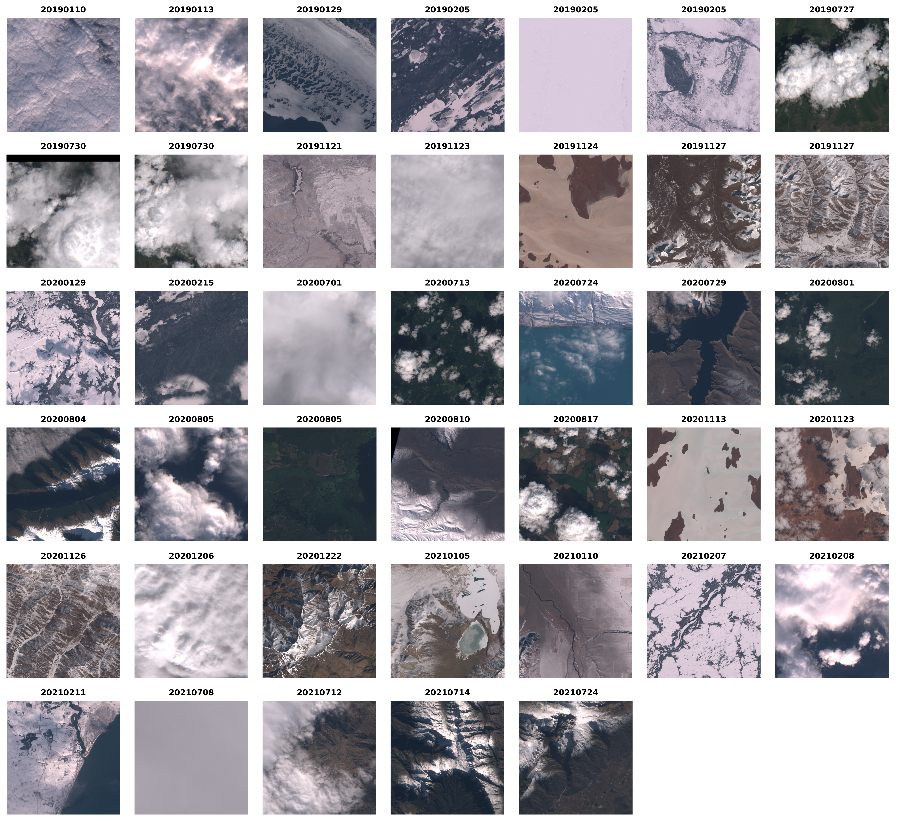

# Global Scene-Level Evaluation (Wang 2022 Dataset)

This directory contains the scripts and outputs for the **Scene-Level (Global) Evaluation** of the SPUN pipeline. Unlike the 1km × 1km chip-based evaluation, this pipeline assesses model performance across larger scenes (extracted from the [Wang et al. 2022](https://github.com/yiluyucheng/SnowCoverage/tree/main) test set).

It also houses the ablation studies and sensitivity analyses used explore the impact of **CloudScore+** masking on SPUN's performance.

These are the 40 image in the [Wang et al. 2022](https://github.com/yiluyucheng/SnowCoverage/tree/main) dataset:



## 📂 Directory Structure

```text
global_wang2022/
├── scripts/                         # Python scripts
├── cloud_mask_ablation_study/       # Outputs: Masked vs Unmasked comparison reports
├── cloud_sensitivity_output/        # Outputs: CloudScore+ threshold tuning plots/reports
└── unified_global_comparison/       # Outputs: SPUN vs Wang vs LIS global metrics & CMs

```

---

## 🛠️ Scripts & Usage

All scripts utilise `argparse` for dynamic execution and should be run from the root of this directory.

### 1. Unified Global Comparison

**Script:** `scripts/unified_global_comparison.py`
**Purpose:** Calculates comprehensive 3-Class (Snow, Cloud, Background) and Binary Snow metrics for SPUN, Wang 2022, and the Let It Snow (LIS) operational baseline. Evaluates on both the maximum 6-tile dataset and the 4-tile LIS subset. Generates a global text report and 10 distinct Confusion Matrices.

```bash
python scripts/unified_global_comparison.py \
    --gt_dir <path_to_wang_masks> \
    --spun_dir <path_to_spun_predictions> \
    --wang_dir <path_to_wang_predictions> \
    --lis_dir <path_to_lis_fsc_folders> \
    --output_dir unified_global_comparison

```

### 2. Cloud Mask Ablation Study

**Script:** `scripts/cloud_mask_ablation_study.py`
**Purpose:** Quantifies the impact of integrating the CloudScore+ mask. Compares raw SPUN predictions (No Mask) against the final operational pipeline (With Cloud Mask) to measure reductions in False Positives caused by cloud confusion.

```bash
python scripts/cloud_mask_ablation_study.py \
    --gt_dir <path_to_wang_masks> \
    --nomask_dir <path_to_raw_spun_predictions> \
    --masked_dir <path_to_masked_spun_predictions> \
    --output_dir cloud_mask_ablation_study

```

### 3. CloudScore+ Sensitivity Analysis

**Script:** `scripts/cloudscore_sensitivity_analysis.py`
**Purpose:** Sweeps through `cs_cdf` (clear probability) thresholds from 0.1 to 0.9 to find the optimal cut-off for masking clouds without aggressively eroding True Positive snow pixels. Generates a text report and a visual sensitivity curve.

```bash
python scripts/cloudscore_sensitivity_analysis.py \
    --gt_dir <path_to_wang_masks> \
    --spun_dir <path_to_spun_predictions> \
    --cloud_dir <path_to_cloudscore_tifs> \
    --output_dir cloud_sensitivity_output

```

### 4. 4-Row Visual Assessment

**Script:** `scripts/plot_4row_assessment.py`
**Purpose:** Generates a high-resolution, publication-ready grid visualising the 6 core test tiles. Rows display: (1) Gamma-corrected Sentinel-2 RGB, (2) Continuous Predicted SCF, (3) Binary Prediction Map, and (4) Ground Truth Label.

```bash
python scripts/plot_4row_assessment.py \
    --gt_dir <path_to_wang_masks> \
    --spun_dir <path_to_spun_predictions> \
    --output_dir .

```

### 5. Grid Visualisations

**Scripts:** `scripts/plot_full_prediction_grid.py` & `scripts/plot_full_s2_image_grid.py`
**Purpose:** Utility scripts for qualitative assessment. They generate massive 7-column grids showing either the categorical predictions or the brightened Sentinel-2 RGB inputs for all 40 full-scene tiles processed by the model.

```bash
# Plot Predictions
python scripts/plot_full_prediction_grid.py \
    --pred_dir <path_to_predictions> \
    --output_dir . \
    --output_name spun_40_grid.png

# Plot Sentinel-2 Inputs
python scripts/plot_full_s2_image_grid.py \
    --s2_dir <path_to_predictions> \
    --output_dir . \
    --output_name s2_rgb_40_grid.png

```

---

## 📊 Outputs generated in this directory:

* **Text Reports:** Detailed metrics, counts, and macro-averages for pipeline performance.
* **Confusion Matrices (`.png`):** Visual breakdowns of True/False Positives & Negatives.
* **Grid Plots (`.png`):** High-level qualitative views of model success and failure modes across complex terrain.